# Informe unificado de resultados: Jenkins y entrenamiento de clasificación crediticia

Proyecto cdp_2026 · Evidencia de ejecución, modelos, integración GitHub y estado de GCP

## Jenkins y clasificación crediticia
Informe unificado de resultados

Proyecto cdp_2026 | Corte: 9 de noviembre de 2026. Este documento reúne la implementación, los resultados medidos y las capturas reales del navegador. Su alcance es académico y de prueba; no acredita un modelo listo para producción.

La primera validación local (#5) y cloud (#1 del job original) completó 165 pruebas, entrenamiento temporal, controles de calidad, aprobación de admin y notificación. Después se activó un segundo job desde GitHub para verificar push y merge reales. Las ejecuciones y sus revisiones se distinguen para no atribuir pruebas nuevas a capturas históricas.

| Entregable | Estado comprobado |
| --- | --- |
| Jenkins local y GCP | Histórico local #5 y cloud #1: SUCCESS, 165 tests. Integración posterior GitHub: job independiente con pruebas ampliadas. |
| Activación automática | Webhook GitHub activo. Push y merge reales en la rama de laboratorio; ver sección 9. |
| Comparación de modelos Python | Regresión logística, árbol, random forest y dos referencias evaluados con el mismo holdout. |
| Vertex AI y AutoML | Vertex CPU y AutoML: SUCCEEDED desde el dashboard. Comparación medida y evaluación nativa de incumplimiento incluidas. |
| Control de costos y vencimiento | Parada programada el 13/11/2026 a las 02:41:05 UTC y limpieza desde un minuto después. |

Los entrenamientos personalizados de Jenkins y Vertex reprodujeron las métricas de Python. AutoML clásico finalizó el 9/11/2026 a las 04:55:04 JST, con presupuesto autorizado de 1 hora-nodo. ROC-AUC de incumplimiento: Python/Vertex CPU 0,6573 y AutoML 0,6542. La detección sigue siendo limitada; no se demuestra superioridad general. Cloud Run recibe el webhook de GitHub.

El PDF incorpora las imágenes. El paquete ZIP añade originales PNG, fuente editable, índices y anexos de operación. No incluye contraseñas, tokens, estado de Terraform ni registros individuales del conjunto de datos.

## 1. Entorno, cuentas y configuración

| Elemento | Configuración verificada |
| --- | --- |
| Repositorio | https://github.com/03loveslollipop/cdp_2026 | rama original: feat/bigquery-ingestion-pipeline |
| Organización / aprovisionamiento | 02labs.me (408308144073) | contact@02labs.me |
| Proyecto Jenkins | nb-core-dev-99d0 | VM semester-jenkins | us-central1-a |
| Cómputo y persistencia | e2-medium, 2 vCPU, 4 GB RAM; disco de arranque pd-balanced de 40 GB; volumen Docker persistente. |
| Controlador | Jenkins 2.580.2, Java 21, Python 3.13 CPU. Builds históricos con 71 plugins; integración GitHub con 76 plugins compatibles. |
| Acceso | Local: 127.0.0.1:18081. GCP: túnel IAP en 127.0.0.1:18083. Sin ingreso público a la consola. |
| Proyecto de entrenamiento | nb-risk-ml-dev-99d0, separado de Jenkins. Pipeline personalizado y AutoML completados desde el dashboard japonés. |
| Facturación | Billing Account for Education | 01ADCB-D56D56-B45DCC | USD. |

Terraform creó la infraestructura de Jenkins y una política independiente de vencimiento. La identidad del controlador solo lee su repositorio de imágenes y sus dos secretos; no recibe permisos de entrenamiento en Vertex. No se generaron claves de cuentas de servicio. El receptor webhook usa Cloud Run y conectividad VPC privada; la consola sigue detrás de IAP.

La VM se eligió por la persistencia y el trabajo continuo de Jenkins, incluidos polling y aprobaciones. Las credenciales y el estado del navegador se conservan fuera de la evidencia compartida. La configuración de cuentas y recursos se registra además en CLOUD_DEPLOYMENT_INVENTORY.md, en la raíz del workspace.

La actualización amplió el lock a 76 plugins compatibles. GitHub 1.47.0 y JUnit 1458.v38661c0638e2 están activos también en GCP. Los cinco plugins adicionales se cargaron dinámicamente comprobando hashes; la VM y su volumen no se reemplazaron y el historial anterior se conserva.

## 2. Procedimiento reproducible de Jenkins

1. Preparar un snapshot Git aislado y las credenciales locales con python3 ci/prepare_local.py. Descargar y verificar los plugins con python3 ci/jenkins/fetch_plugins.py. Levantar Jenkins y el receptor de notificaciones con docker compose up -d --build.

2. Abrir Jenkins, autenticarse y revisar el job credit-classification. En Configure → Pipeline se seleccionó Pipeline script from SCM, Git, file:///opt/source, rama */ci-review y archivo Jenkinsfile. El checkout pertenece al workspace del job y no requiere subir con dir("..").

| Etapa | Acción y criterio |
| --- | --- |
| Clone repository | Limpiar el workspace del job, clonar SCM y conservar el SHA efectivo del checkout. Es la primera etapa. |
| Validate structure | Comprobar archivos, configuraciones, objetivo y separación cronológica sin variables excluidas. |
| Repository tests | Ejecutar la suite real y producir JUnit XML; un fallo detiene la aprobación. |
| Train and evaluate | Entrenar y evaluar candidatos con cinco bloques temporales y semillas 42, 43 y 44. |
| Quality and stability | Aplicar umbrales de validación y estabilidad; publicar métricas y gráficos antes de pedir aprobación. |
| Approve model | Solicitar revisión a admin; tiempo máximo de espera de 20 minutos. |
| Record approval / Post | Registrar aprobador, URL y commit; publicar JUnit y artefactos agregados; enviar notificación autenticada. |

3. Pulsar Build Now, observar consola y etapas, revisar los artefactos y completar Approve model. Verificar por separado el resultado global, el reporte de pruebas, el recibo de aprobación y la recepción de la notificación.

La ejecución completa tiene un límite de 45 minutos, un executor, dos hilos de CPU y sin builds concurrentes del job. Se conservan diez ejecuciones. El despliegue en GCP usa Terraform, imagen fijada por digest, Secret Manager y el mismo flujo de verificación en el navegador.

## 3. Evidencia: pipeline en ejecución

Desde el navegador se inició el build cloud #1 y se observaron la consola y Stage View mientras ejecutaba trabajo. Las imágenes siguientes son capturas originales de Playwright; no son recreaciones del resultado.

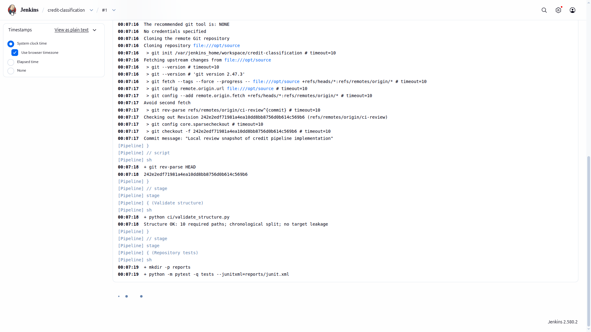

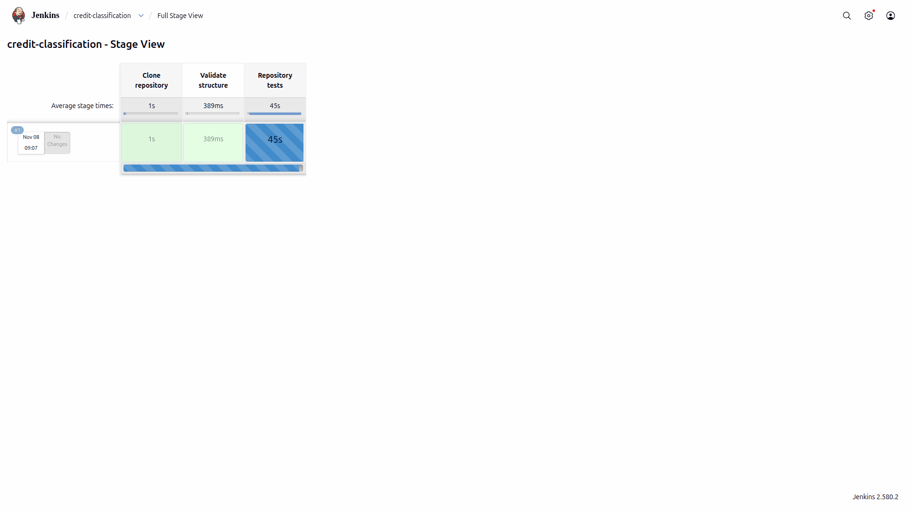

Para reproducir: abrir credit-classification, seleccionar el número de build y entrar a Console Output / Stage View. El archivo index.json de evidencia conserva URL, fecha de captura UTC y SHA-256 de las capturas originales.

## 4. Evidencia: calidad y aprobación humana

Los controles se aplican al modelo seleccionado con validación temporal, antes de utilizar el holdout como auditoría. La evidencia agregada está disponible para el revisor durante la pausa de aprobación.

| Control | Valor medido | Política | Resultado |
| --- | --- | --- | --- |
| F1 medio de validación | 0,1871 | ≥ 0,10 | Cumple |
| ROC-AUC medio de validación | 0,6650 | ≥ 0,50 | Cumple |
| Desviación F1 temporal | 0,0292 | ≤ 0,15 | Cumple |
| Desviación F1 entre semillas | 0,0110 | ≤ 0,05 | Cumple |

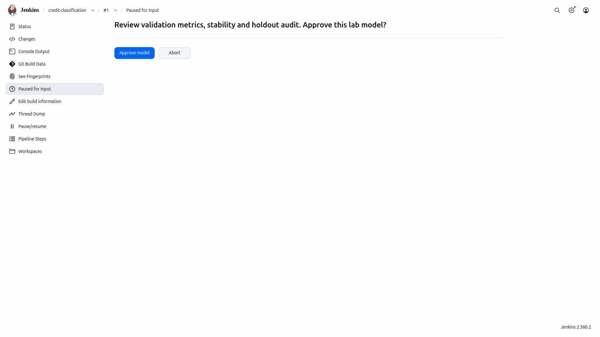

La autorización se registra con identidad, URL del build y SHA de origen. Estos umbrales son reglas versionadas del ejercicio; superarlos no equivale a una certificación de riesgo de modelos para producción.

## 5. Evidencia: pruebas y cierre del proceso

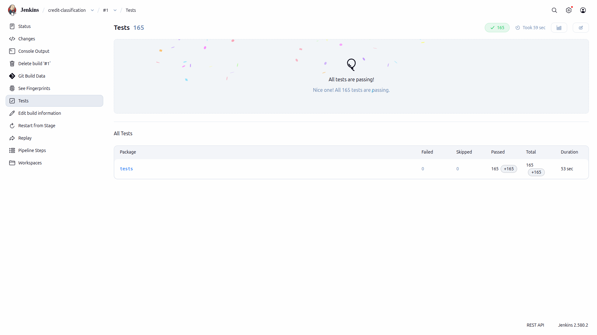

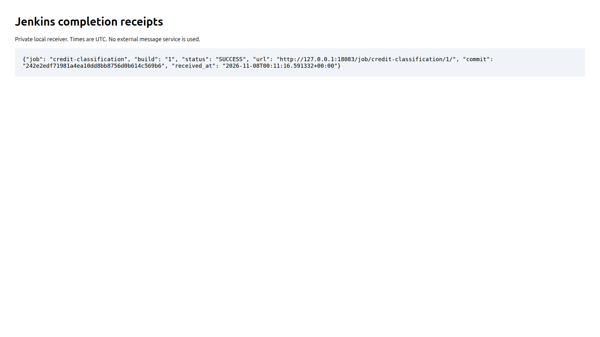

| Entorno / build | Estado | Pruebas | Duración total |
| --- | --- | --- | --- |
| Local #5 | SUCCESS | 165 / 0 / 0 | 193,02 s |
| GCP #1 | SUCCESS | 165 / 0 / 0 | 247,30 s |

Las duraciones incluyen la espera de aprobación. La notificación es un webhook hacia el receptor privado del laboratorio; no es un correo ni un mensaje enviado a un servicio externo. El recibo de aceptación acredita entrega y se revisó junto con el resultado final de Jenkins.

## 6. Evidencia: resultado final y automatización

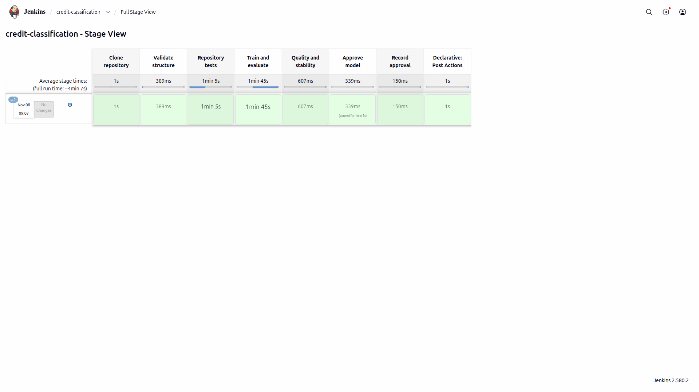

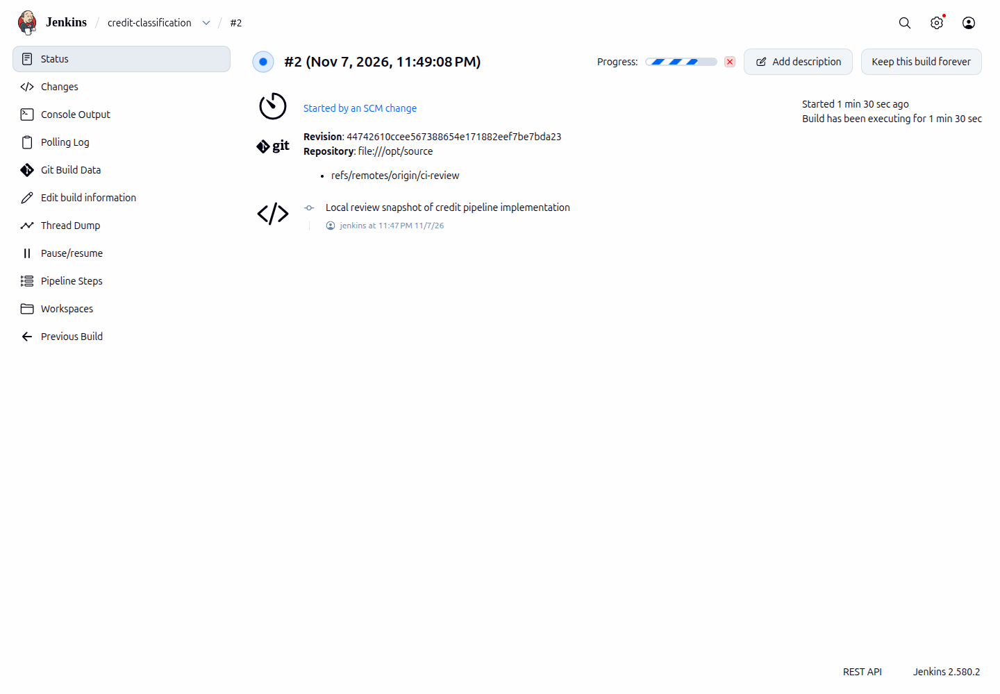

El polling H/2 * * * * observa la rama configurada cada dos minutos aproximadamente y solo ejecuta cuando encuentra cambios. El build local #5 se originó por SCM; el cloud #1 fue iniciado por admin.

La evidencia histórica de polling se obtuvo sobre un snapshot aislado. Posteriormente se publicó la implementación en GitHub y se verificaron pushes reales, incluido el de un merge, con el nuevo job credit-classification-github. Sus capturas y recibos se presentan en la sección 9.

## 7. Resultados de clasificación crediticia

Conjunto de 10.763 registros: 7.534 para entrenamiento y 3.229 para holdout cronológico. Incumplimiento corresponde a Pago_atiempo=0. El random forest fue seleccionado con validación previa al holdout; no se cambió el ganador al inspeccionar resultados de prueba.

| Modelo Python | Accuracy | F1 impago | Recall impago | ROC-AUC | AP |
| --- | --- | --- | --- | --- | --- |
| Regresión logística | 0,9080 | 0,1134 | 0,1759 | 0,6278 | 0,0652 |
| Árbol de decisión | 0,9297 | 0,1498 | 0,1852 | 0,6084 | 0,0591 |
| Random forest seleccionado | 0,8250 | 0,1130 | 0,3333 | 0,6573 | 0,0994 |
| Referencia heurística | 0,7928 | 0,0798 | 0,2685 | 0,6241 | 0,0858 |
| Dummy mayoritario | 0,9666 | 0,0000 | 0,0000 | 0,5000 | 0,0334 |

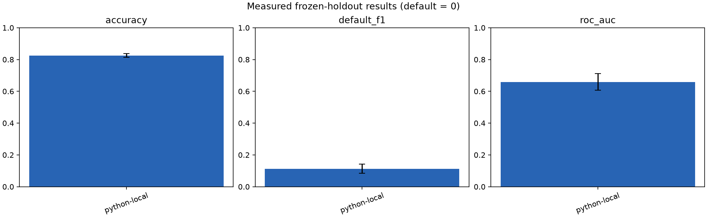

La exactitud aislada resulta engañosa: el dummy logra 96,66 % sin identificar un solo incumplimiento. El bosque detecta 36 de 108 incumplimientos y genera 493 falsos positivos. Su F1 bajo y el costo operativo de esas alertas requieren revisión antes de cualquier uso real.

AP significa average precision de scikit-learn; no debe mezclarse sin aclaración con auPrc nativo de AutoML. RMSE no es la métrica principal de este problema de clasificación binaria.

## 8. Estabilidad, incertidumbre y límites

Para el bosque seleccionado, F1 medio en validación temporal = 0,1871; desviación entre bloques = 0,0292; desviación entre semillas 42/43/44 = 0,0110. La evaluación emplea cinco bloques cronológicos. El umbral de incumplimiento fijado con validación es aproximadamente 0,08828.

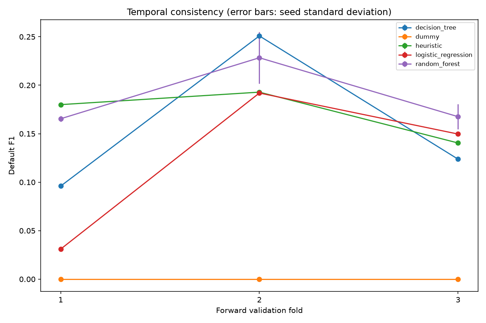

| Indicador del bosque en holdout | Estimación | IC bootstrap 95 % |
| --- | --- | --- |
| Accuracy | 0,8250 | [0,8132; 0,8365] |
| F1 de incumplimiento | 0,1130 | [0,0845; 0,1413] |
| ROC-AUC | 0,6573 | [0,6073; 0,7108] |

Los intervalos usan 200 remuestreos estratificados y describen incertidumbre del holdout observado, no consistencia de reentrenamiento. La prevalencia de incumplimiento baja de 5,35 % en entrenamiento a 3,34 % en holdout; la caída de F1 obliga a estudiar deriva temporal, calibración y costos de error.

Las coincidencias local/GCP prueban reproducibilidad para la imagen, datos y protocolo ensayados. El holdout ya había sido inspeccionado en el EDA anterior; hace falta una muestra externa nueva para sostener una conclusión independiente de generalización. La disponibilidad de predictores en el momento de decisión sigue siendo un supuesto del contrato de datos.

## 9. GitHub: webhook desplegado

La cuenta propietaria 03loveslollipop quedó autenticada con ADMIN. Se publicó la implementación en ci/jenkins-lab-20261108 y se creó el webhook 708866067, activo, para el evento push. No se modificó master ni se activaron sus despliegues Heroku.

| Configuración | Valor desplegado |
| --- | --- |
| Receptor HTTPS | https://semester-jenkins-webhook-tcwenm7hba-uc.a.run.app/github-webhook/ |
| Cloud Run / proyecto | semester-jenkins-webhook / nb-core-dev-99d0 / us-central1 |
| Capacidad | 1 vCPU, 256 MiB; mínimo 1 y máximo 1; CPU limitada en inactividad. |
| Red privada | Direct VPC egress, 10.81.1.0/26 → Jenkins 10.81.0.3:8080. |
| Firma y secreto | HMAC SHA-256 validado en relay y Jenkins; secreto en Secret Manager y credencial SYSTEM. |
| Job / fuente | credit-classification-github / GitHub HTTPS / */ci/jenkins-lab-20261108 |
| Trigger | githubPush(); polling H/2 como respaldo. |
| Vencimiento | 13/11/2026 02:41:05 UTC; no se amplió el plazo. |

El receptor rechaza firmas inválidas (403), repositorios distintos y referencias fuera del alcance; solo reenvía el webhook autorizado. La raíz responde 404 y la consola Jenkins no se expone. Antes de cada prueba de trigger se pausó el cron SCM: el build quedó atribuido a Started by GitHub push by 03loveslollipop.

La activación solo cubre la rama vigilada del laboratorio. Los checks de PR previos al merge en Jenkins requerirían Multibranch/GitHub Branch Source; el repositorio ya tiene un workflow GitHub Actions separado. La recepción HTTP no sustituye la comprobación de SHA, pruebas y finalización.

## 9.1. Evidencia del trigger y del checkout

GitHub entregó el push directo y el push de integración con HTTP 200. Jenkins registró GitHubPushCause, con el cron SCM temporalmente vacío antes de cada evento. Se verificó igualdad entre SHA del evento, revisión SCM y recibo de aprobación. El Jenkinsfile restauró después el polling H/2.

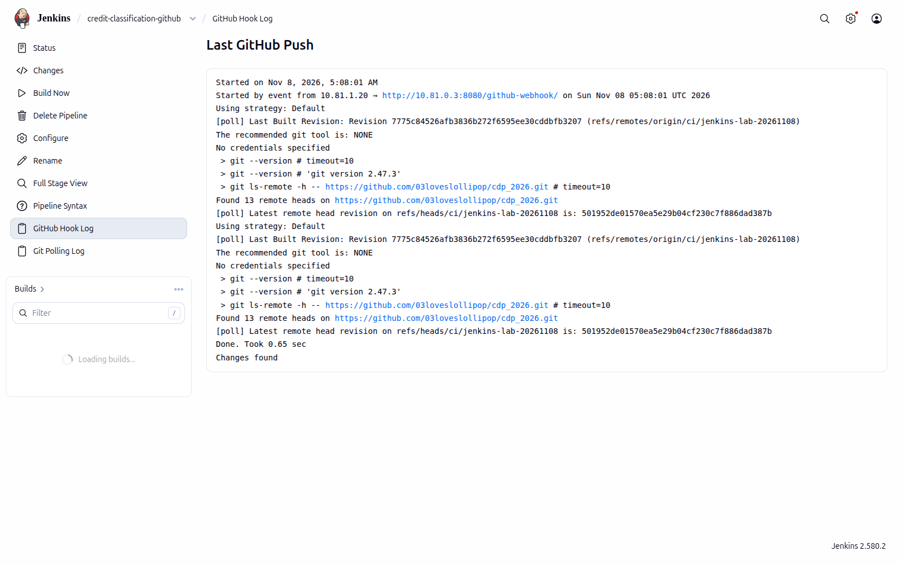

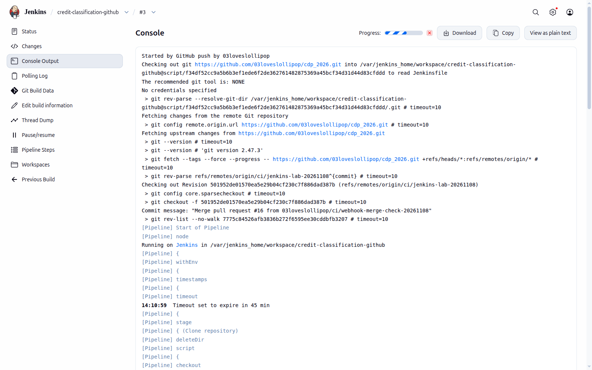

Las capturas pueden mostrar la zona horaria del navegador; el índice y los recibos conservan UTC. No se utilizó una captura de consola todavía vacía como prueba de ejecución.

## 9.2. Merge real y casos de entrega

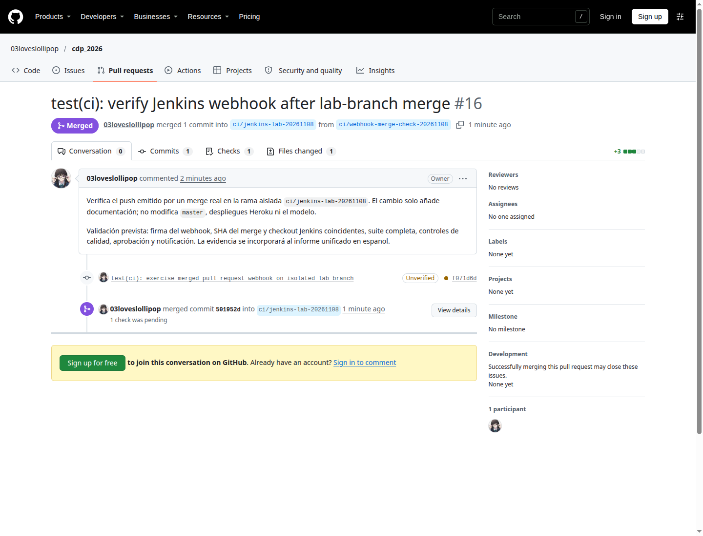

| Caso observado | HTTP / efecto |
| --- | --- |
| Push 7775c845… | 200; inicia build #2 del job GitHub. |
| Merge PR #16 → 501952de… | 200; inicia build #3. |
| Push a la rama del PR | 202; ignorado por el job de laboratorio. |
| Reentrega del push original | 200, duplicate: true; no se inicia un build extra. |
| Firma inválida / ruta raíz | 403 / 404; no expone la consola. |

Estos resultados se verificaron con la API real de entregas de GitHub y los recibos Jenkins. Abrir o actualizar un PR todavía no ejecuta este job de rama única antes del merge. El workflow GitHub Actions del repositorio es independiente y su resultado no se confunde con el de Jenkins.

## 9.3. Resultado de los builds GitHub

| Build / origen | Resultado | Pruebas P/F/O | Duración total |
| --- | --- | --- | --- |
| #1 / bootstrap | SUCCESS | 185/0/0 | 305.03 s |
| #2 / push | SUCCESS | 186/0/0 | 229.81 s |
| #3 / merge | SUCCESS | 186/0/0 | 246.33 s |

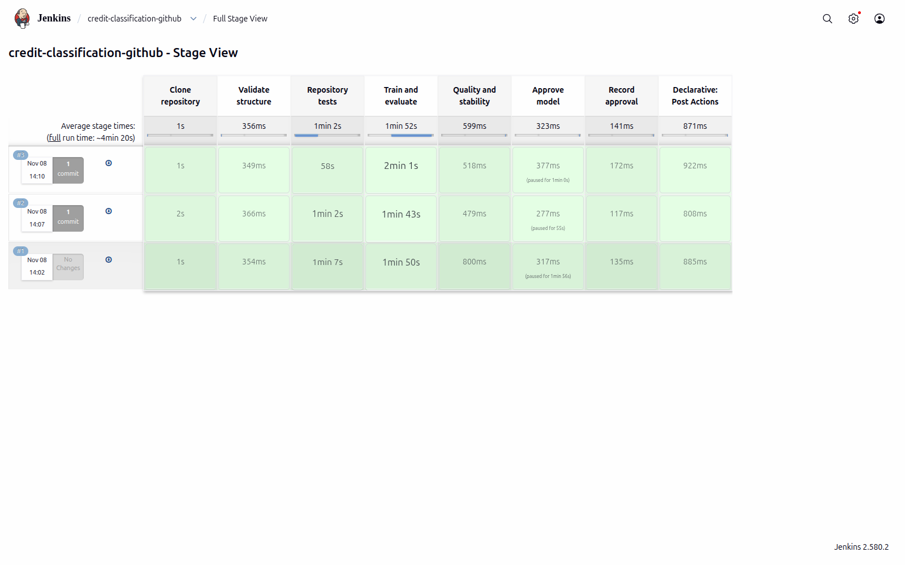

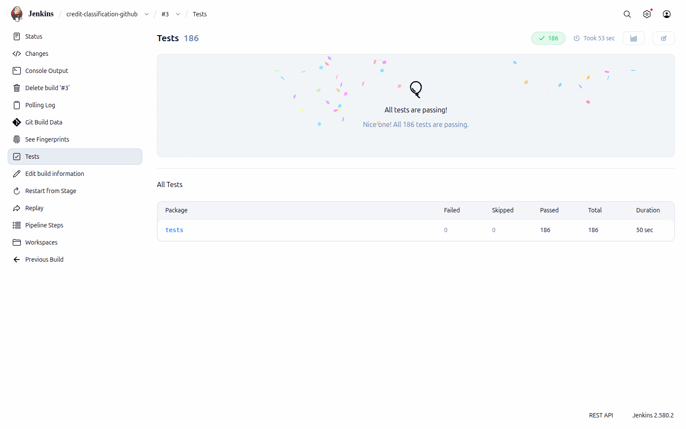

Las dos ejecuciones automáticas superaron las puertas del modelo y fueron aprobadas por admin. Las métricas del bosque coinciden con la evaluación original a tolerancia 1e-12. Los 186 casos incluyen las regresiones del hook y del receptor; no se atribuyen retrospectivamente a los builds históricos de 165 pruebas.

## 9.4. Notificaciones y trazabilidad GitHub

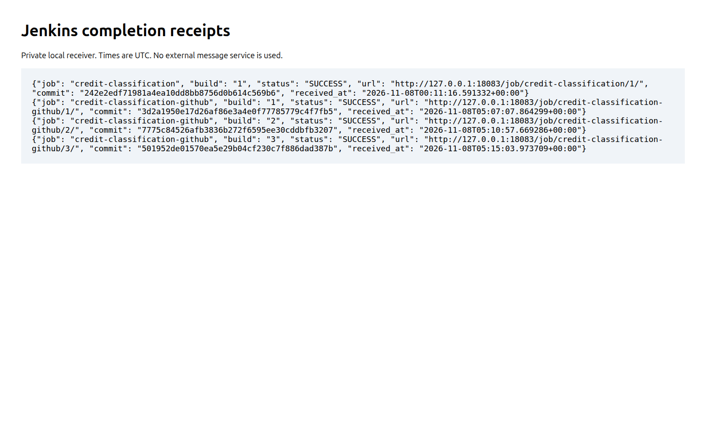

Push directo: 7775c84526afb3836b272f6595ee30cddbfb3207. Merge: 501952de01570ea5e29b04cf230c7f886dad387b. Cada recibo incluye URL del build, estado, revisión y hora UTC de aceptación.

La documentación conserva el ping inicial HTTP 403, la corrección del secreto y el ping reentregado con HTTP 200. El PR de ensayo también mostró un fallo del workflow GitHub Actions por un import pytest sin uso en una prueba BigQuery anterior; se retiró ese import y Ruff pasó en la revisión final. Ese fallo histórico no se presenta como si el workflow hubiese pasado.

Fuentes de evidencia: github-verification.json, cleanup-verification.json y anexos de output/github-webhook/. Los JSON publicados contienen métricas agregadas y metadatos de ejecución; no incluyen tokens, contraseñas ni predicciones individuales.

## 10. GCP: acceso, proyecto y datos

El usuario autorizó la fase GCP e inició sesión en el navegador persistente semester-gcp. Se verificó contact@02labs.me, cuenta administrada por 02labs.me, y el proyecto novabank-riesgo-ml-dev (nb-risk-ml-dev-99d0, número 727006212991). Se reutilizó este proyecto existente del área de riesgo. La consola permanece en japonés por instrucción del usuario.

Se habilitó la API de Vertex AI desde la consola, actualmente presentada como Agent Platform. Se creó un bucket privado Standard en us-central1 con acceso uniforme y prevención de acceso público; se subieron raw.csv, automl.csv, holdout-features.csv y manifest.json. Las etiquetas del holdout se conservan locales.

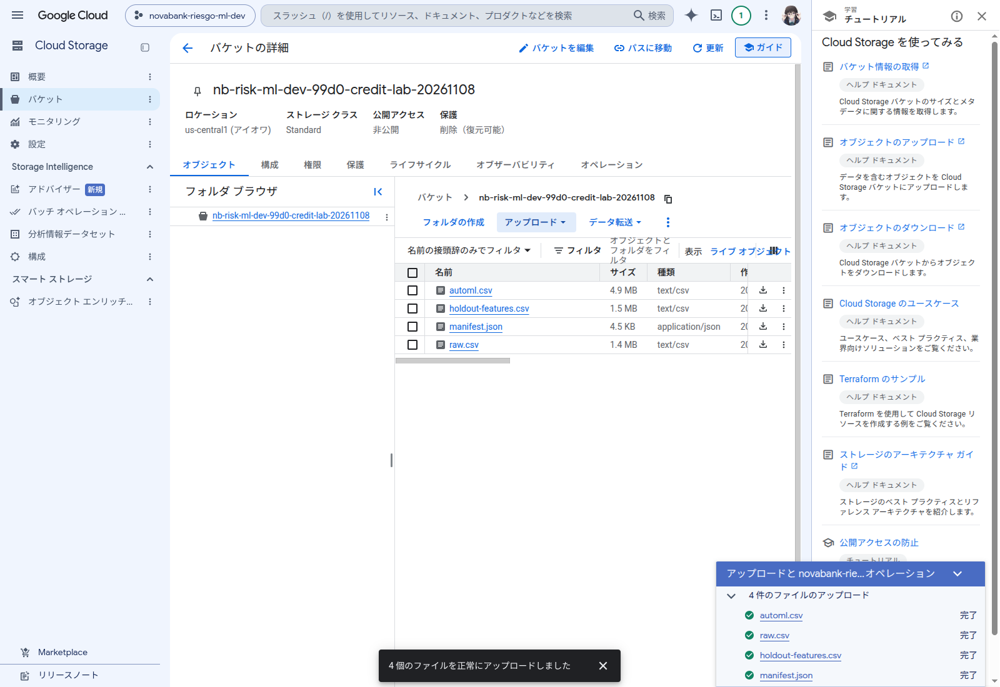

Exportación real: output/cloud-data-gcp. Particiones cronológicas: 6.027 TRAIN, 1.507 VALIDATE y 3.229 TEST. El nombre oficial de la partición de validación es VALIDATE. Las huellas de dataset y holdout coinciden con el benchmark local.

## 10.1. Dataset y preparación de AutoML

Se creó el dataset tabular credit-classification-temporal-20261108, ID 2799060011056103424, región us-central1. La fuente es gs://nb-risk-ml-dev-99d0-credit-lab-20261108/automl.csv. Se solicitó generar estadísticas; esta operación es preparación de datos, no entrenamiento de un modelo.

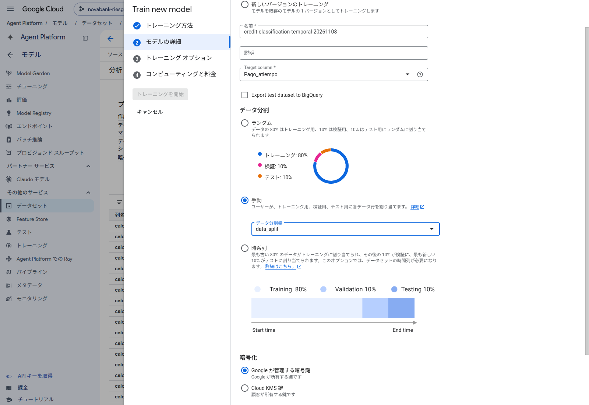

Se configuró el objetivo Pago_atiempo y el reparto manual para conservar las mismas filas de prueba. La opción de AutoML sobre Pipelines exige Dataflow y servicios adicionales; se revisó su pantalla sin lanzar el workflow. La documentación anexa conserva los pasos y las capturas originales.

## 10.2. Presupuesto inicial y nueva autorización

En la primera etapa, el usuario indicó USD50 de créditos y un límite de aproximadamente USD15. AutoML exige entre 1 y 72 horas-nodo; el intento de configurar 0,7 fue rechazado y el formulario se canceló sin enviar entrenamiento. Posteriormente, el 9/11/2026 JST, el usuario autorizó explícitamente aproximadamente USD21,25 para una ejecución de 1 hora-nodo.

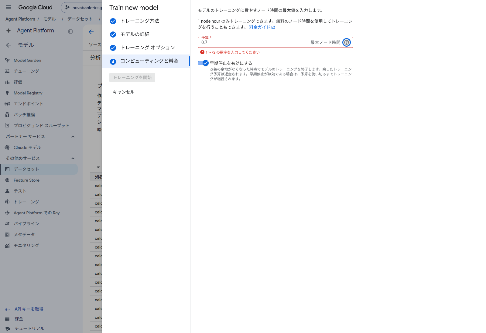

La tarifa pública estándar es USD21,252 por hora-nodo de clasificación/regresión. El mínimo superaba el límite inicial de USD15. La nueva autorización permitió enviar exactamente 1000 milli-node-hours, con early stopping. Se mantuvo la opción clásica; el workflow alternativo con Dataflow no se envió. El ejemplo público de ese workflow, USD27,03 sin destilación, no es una cotización de este dataset.

Estado final: AutoML completado con exactamente el presupuesto autorizado. La comparación incorpora Python local, Vertex CPU y la evaluación nativa de la clase 0. No se crearon endpoints ni predicciones batch. Las capturas de presupuesto inicial se conservan como historia, separadas del envío posterior.

## 10.3. Pipeline personalizado de bajo costo

Se preparó una imagen Python/scikit-learn en Artifact Registry, fijada por digest inmutable, y una especificación KFP real para cargar en el dashboard. Esta preparación por CLI no envía entrenamiento; la ejecución se crea desde la consola japonesa.

| Control | Configuración |
| --- | --- |
| Región y recursos | us-central1; 2 CPU, memoria 8G; sin GPU |
| Límite del cuerpo de entrenamiento | 600 segundos; no incluye provisión ni espera del servicio |
| Reintentos y caché | Cero reintentos automáticos; caché desactivada |
| Identidad | credit-semester-pipeline; sin claves; bucket y repositorio acotados |
| Entrada | raw.csv; verificación de huellas de dataset y holdout |
| Salida | Artefactos y métricas; sin endpoint permanente |

Se reutiliza el protocolo local: selección previa al holdout, folds temporales y tres semillas. La alarma limita el código, no constituye un tope monetario de facturación. La comparación final se construyó con los artefactos de la ejecución exitosa r3.

Demostración Vertex CPU: 212 s en una réplica e2-highmem-2, aproximadamente USD0,0061 de cómputo a tarifa de lista. Contando conservadoramente USD0,03 por cada uno de los 3 pipelines creados, el subtotal es USD0,0961, más SSD temporal, almacenamiento y operaciones. Se espera un importe del orden de centavos y muy inferior a USD15; es una estimación, no una factura ni un tope garantizado. Los recursos de riesgo retenidos siguen generando pequeños cargos de almacenamiento.

## 10.4. Evidencia del pipeline en ejecución

La ejecución r3 fue enviada desde el dashboard y pasó a RUNNING el 08/11/2026 a las 09:52:33 UTC, tras dos envíos fallidos antes de crear workers por acceso inicial del agente a Artifact Registry. IAM Troubleshooter confirmó acceso; se conservan todos los estados. Vertex asignó una réplica e2-highmem-2 y disco temporal SSD de 100 GB, sin GPU. Solicitud del componente: 2 CPU y memoria 8G; máquina compatible asignada: 2 vCPU y 16 GiB.

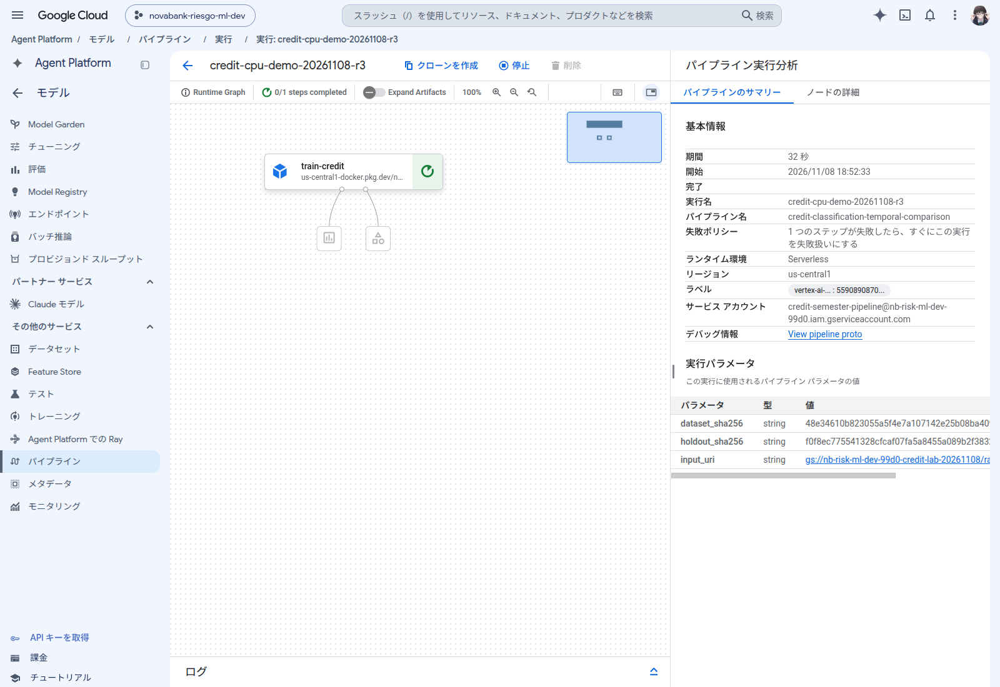

El pipeline conserva dos artefactos de salida: results y metrics. La vista de tarea muestra los hashes de entrada, la imagen por digest y el CustomJob asociado. El estado RUNNING confirma orquestación activa; la disponibilidad de métricas se comprueba al finalizar el worker.

## 10.5. Evidencia del entrenamiento y sus logs

El CustomJob comenzó su ejecución el 08/11/2026 a las 09:58:45 UTC. El dashboard y Cloud Logging muestran búsqueda real de regresión logística, árbol y random forest, con evaluación temporal. El nodo del pipeline incluye la espera de provisión en su duración; no es una medida de tiempo puro de entrenamiento.

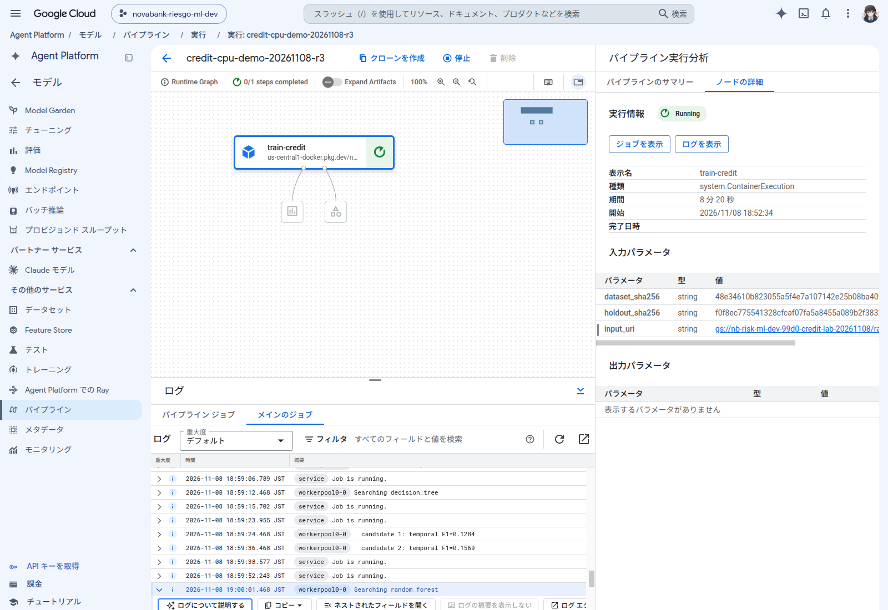

Se conservan dos envíos fallidos al inicio, antes de crear workers, y la ejecución r3 completada correctamente. La prueba no usa GPUs, Dataflow ni endpoints online. Los artefactos exportados se verificaron antes de añadir la comparación cuantitativa.

## 10.6. Finalización y métricas del dashboard

Resultado comprobado: pipeline credit-cpu-demo-20261108-r3, SUCCEEDED el 08/11/2026 a las 10:02:37 UTC. CustomJob 1394998308224630784: SUCCEEDED, 09:58:45–10:02:17 UTC, 212 segundos. El dashboard conserva la relación entre el run, la tarea, los datos y los artefactos. El modelo se conserva como best_model.joblib en el bucket privado; no se desplegó un endpoint.

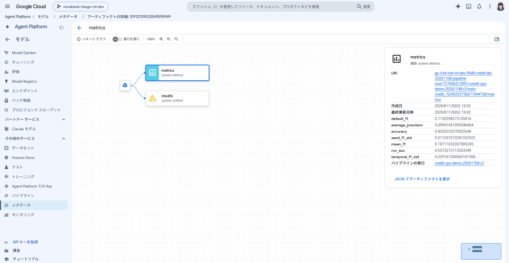

Se descargaron modelo, tablas, predicciones y figuras del artefacto results, sin enviar nuevos jobs. La huella de cada archivo, el estado completo y los resultados de verificación se conservan en los anexos GCP. La captura 34 documenta el DAG finalizado con sus logs.

## 10.7. Comparación final: Python, Vertex y AutoML

Holdout cronológico: 3.229 filas, 108 incumplimientos (clase 0). Python y Vertex CPU reprodujeron el mismo forest y métricas (diferencias < 1e-12). AutoML se evalúa con su slice nativo de clase 0; la matriz coincide en total y prevalencia con TEST.

| Métrica | Python | Vertex CPU | AutoML |
| --- | --- | --- | --- |
| Accuracy | 0,825023 | 0,825023 | 0,962527 |
| Precisión clase 0 | 0,068053 | 0,068053 | 0,259259 |
| Recall clase 0 | 0,333333 | 0,333333 | 0,064815 |
| F1 clase 0 | 0,113030 | 0,113030 | 0,103704 |
| ROC-AUC clase 0 | 0,657321 | 0,657321 | 0,654208 |
| AP sklearn | 0,099415 | 0,099415 | No disponible |
| PR-AUC nativo | No disponible | No disponible | 0,120123 |
| Umbral P(clase 0) | 0,088279 OOF | 0,088279 OOF | 0,5 fijo |

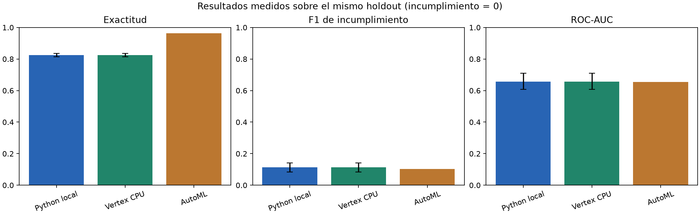

F1/recall comparan políticas de umbral diferentes además de modelos; ningún umbral se ajustó al TEST. ROC-AUC es similar. AutoML tiene mayor accuracy, pero queda debajo del dummy (0,9666, sin detectar incumplimientos). No se interpreta accuracy como capacidad de detectar riesgo.

## 10.8. Evidencia de créditos y facturación

Cuenta educativa: Billing Account for Education, 01ADCB-D56D56-B45DCC, USD. Tras completar AutoML se consultó de nuevo la página de créditos, manteniendo la consola en japonés.

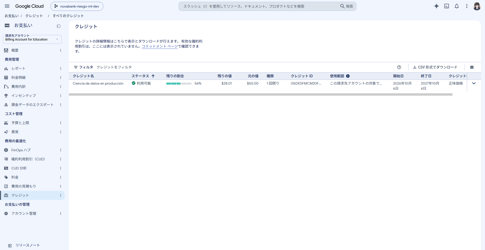

La diferencia acumulada es USD21,99 utilizados en servicios elegibles de toda la cuenta desde la concesión. No se atribuye todo a AutoML y no es una factura desglosada final; el reporte puede tener retraso. El recibo billing-after-automl.json conserva fecha exacta, alcance y SHA-256.

La observación anterior (8/11 UTC) fue USD49,86 restantes y USD0,00 netos en el reporte del 1–8/11. Tiene otro corte temporal y queda como evidencia histórica en los anexos. El límite inicial USD15 fue ampliado expresamente para un solo AutoML de aproximadamente USD21,25; no se amplió para inferencia ni reentrenamiento.

## 10.9. AutoML: presupuesto autorizado y configuración

El usuario autorizó expresamente aproximadamente USD21,25 para un entrenamiento AutoML clásico. Se reutilizaron proyecto, región y dataset existentes. Nombre del modelo solicitado: credit-automl-temporal-20261109. Target Pago_atiempo; división manual data_split; objetivo maximize-au-prc; early stopping habilitado.

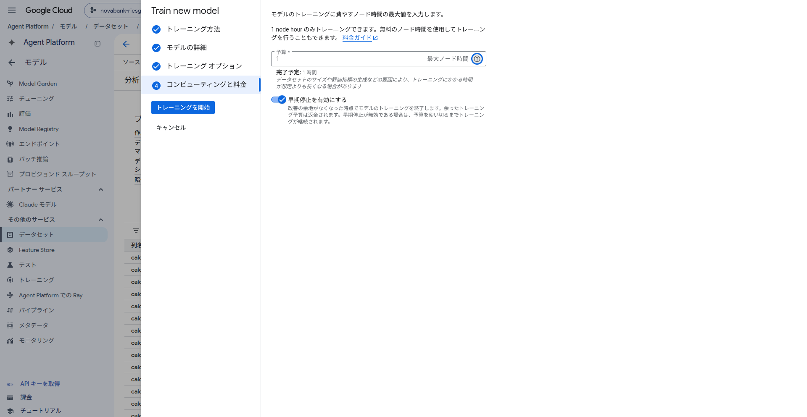

La respuesta real del servicio confirma trainBudgetMilliNodeHours=1000 y 84 transformaciones de predictores. No incluyen target, data_split, row_id, puntaje ni fecha_prestamo. El esquema conserva los mismos grupos TRAIN, VALIDATE y TEST. No se exportó el conjunto TEST a BigQuery.

## 10.10. AutoML: envío confirmado y seguimiento

El servicio aceptó el job 7023547864391352320 el 08/11/2026 a las 17:17:19 UTC (9/11 02:17:19 JST). El estado inicial fue PENDING. Posteriormente la consola confirmó Training e inicio 17:19:36 UTC (02:19:36 JST), con etapa Data preprocessing. La consola indica que notificará por email al finalizar.

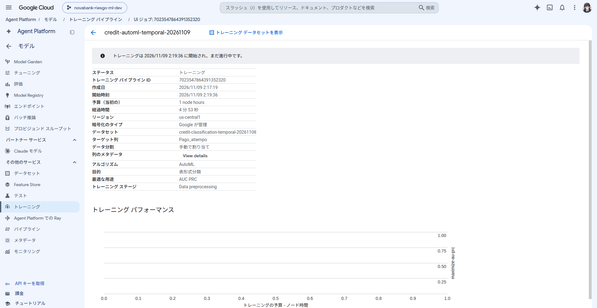

Esta captura documenta la etapa activa, no la finalización. Las páginas siguientes añaden el resultado SUCCEEDED y sus métricas reales. Los recibos 36–43 conservan configuración y seguimiento; 44–52 documentan finalización, evaluación y créditos. Solo se envió un AutoML, sin ampliar el presupuesto ni iniciar inferencia batch o endpoints.

## 10.11. AutoML completado y modelo registrado

Pipeline 7023547864391352320: PIPELINE_STATE_SUCCEEDED. Creado 8/11 17:17:19 UTC, iniciado 17:19:36 UTC y terminado 19:55:04 UTC = 9/11/2026 04:55:04 JST. Se mantuvo la misma ejecución y el presupuesto 1000 milli-node-hours; no se repitió el entrenamiento.

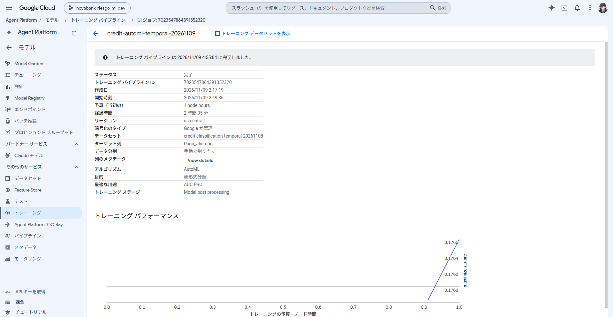

Modelo registrado 3834067964554903552, versión 1, evaluación 2989617876806692894. La duración de pared de 2 h 35 min incluye preparación y postprocesamiento gestionados; no equivale a horas-nodo facturables. El modelo se conserva sin endpoint.

Procedencia: manifest exportado/subido → URI GCS del dataset → división manual data_split → pipeline exitoso → modelo/versión → evaluación de clase 0. Se comprobaron 84 predictores y conteos TEST. Las huellas de datos proceden del manifest local vinculado a esa carga; la API agregada no calcula hashes remotos fila por fila.

## 10.12. Evaluación nativa de incumplimiento

Procedimiento: Model Registry → credit-automl-temporal-20261109 → versión 1 → Evaluación. Seleccionar clase 0, mantener umbral fijo 0,5 y revisar curvas ROC/PR. Se leyeron los recibos mediante GET desde la sesión web autenticada; no se extrajeron tokens ni se enviaron jobs por código.

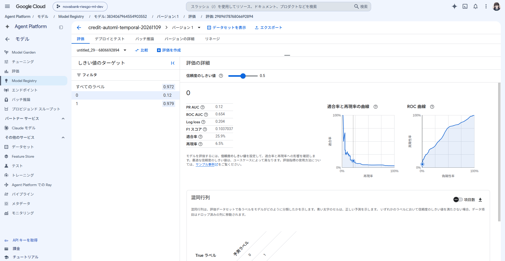

Valores exactos del slice 0: ROC-AUC 0,65420777 y PR-AUC nativo 0,120123096. La vista general micro muestra ROC-AUC 0,9763931 y PR-AUC 0,9719521; no se utilizan para representar detección de incumplimiento. El código valida clase, modelo, versión, evaluación y umbral exacto antes de construir la comparación.

AP sklearn no está disponible para AutoML sin predicciones individuales. PR-AUC nativo tiene otra definición de integración/agrupación y se conserva en una columna distinta. No se concluye mejora comparando directamente 0,1201 con AP 0,0994.

## 10.13. Matriz real y efecto del umbral

En la evaluación se activó el interruptor de conteos de la matriz. Filas: clase real; columnas: clase predicha; orden [0 incumplimiento, 1 pago a tiempo]. Total 3.229 observaciones, 108 incumplimientos.

![Matriz AutoML real a 0,5: [[7,101],[20,3101]]. Siete incumplimientos detectados, 101 omitidos, 20 falsas alarmas y 3.101 pagos a tiempo bien clasificados.](assets/52-automl-confusion-counts-visible-ja.png)

| Conteo / política | Python y Vertex CPU | AutoML |
| --- | --- | --- |
| Incumplimientos detectados / total | 36 / 108 | 7 / 108 |
| Falsas alarmas | 493 | 20 |
| Umbral P(incumplimiento) | ~0,08828; validación OOF | 0,5 fijo |

AutoML reduce falsas alarmas a costa de omitir más incumplimientos en esta política. Las métricas dependen del umbral; no demuestran por sí solas superioridad del algoritmo. El forest fue seleccionado y calibrado antes de TEST; tampoco se ajustó AutoML mirando este holdout.

## 10.14. Estabilidad y entrenamiento manual frente a AutoML

| Aspecto | Python / Vertex CPU | AutoML |
| --- | --- | --- |
| Variación temporal F1 | Desviación 0,029162 | No medida en reentrenamientos |
| Variación entre semillas F1 | 0,011031; semillas 42, 43 y 44 | Una ejecución; no medida |
| Incertidumbre en TEST | Bootstrap condicional de predicciones | Sin predicciones individuales; no calculada |
| Consistencia entre entornos | Mismas huellas y métricas < 1e-12 | Mismos conteos TEST y cadena de procedencia |

La validación temporal media del forest es F1 0,187117; baja a 0,113030 en TEST. La prevalencia cae de 5,35% en el período de entrenamiento a 3,34% en TEST. Esto motiva revisar deriva temporal y calibración. Los intervalos bootstrap condicionan la mezcla observada; no miden varianza de reentrenamiento. Tres semillas constituyen una comprobación académica pequeña.

Manual/Python: control explícito de preparación de variables, folds, selección, calibración, umbrales, semillas y costos. Vertex permite ejecutar ese protocolo con artefactos y orquestación gestionados; reprodujo los resultados, sin mejorar por trasladarlo a cloud.

AutoML: reduce el diseño y búsqueda manual y entrega evaluación/curvas gestionadas. Ofrece menos control de la búsqueda interna y usa un presupuesto mayor en este ejercicio pequeño. Su ROC-AUC de incumplimiento (~0,654) es similar al forest (~0,657); no demuestra ventaja general de calidad.

Límites: solo se ejecutó un AutoML; su consistencia entre reentrenamientos queda sin medir, no igual a cero. No se gastó en repeticiones o batch para completar artificialmente esa evidencia. El holdout ya había sido visto en EDA y la disponibilidad de predictores a la fecha de decisión sigue siendo un supuesto; hace falta validación externa antes de uso real. RMSE no se aplica como métrica de este problema de clasificación.

## 11. Costos y eliminación automática

Cuenta: Billing Account for Education, 01ADCB-D56D56-B45DCC, USD. Tras AutoML: USD28,01 restantes de USD50,00; USD21,99 consumidos por diferencia en toda la cuenta, con posible retraso y sin desglose por job. La estimación de lista AutoML autorizada fue USD21,252 por 1 hora-nodo; la duración de pared de 2 h 35 min no se usa como multiplicador. Jenkins se estima por separado.

| Componente | Estimación por 730 horas |
| --- | --- |
| VM e2-medium | USD 24,46 |
| Disco pd-balanced de 40 GB | USD 4,00 |
| IPv4 externa efímera | USD 3,65 |
| Artifact Registry, aproximadamente 1,407 GiB | USD 0,14 |
| Total orientativo | USD 32,25 al mes; aproximadamente USD 1,06 al día. |

El receptor caliente añade aproximadamente USD 0,27/día (USD 1,35 por cinco días completos) de CPU/memoria en inactividad, antes de franquicias y créditos, más actividad y almacenamiento. La base Jenkins de USD 1,06/día pasa a unos USD 1,33/día con ese supuesto; no es factura consolidada. Se mantiene caliente para atender GitHub sin el retraso posible de un arranque Direct VPC.

Valores antes de créditos, descuentos, impuestos, tráfico y futuras ejecuciones. No representan una factura consolidada de todos los proyectos ni el costo de AutoML. A las 02:32 UTC del 8/11, el período de la VM actual sumaba aproximadamente 2,476 horas, unos USD 0,11 brutos; esa observación no incluye una VM anterior reemplazada.

| Hito de la política | Fecha / alcance |
| --- | --- |
| Parada de la VM | 13/11/2026 02:41:05 UTC = 11:41:05 JST. |
| Primera limpieza | 13/11/2026 02:42:05 UTC. La finalización depende de las APIs. |
| Reintentos | 49 envíos de limpieza cada 30 minutos, hasta 14/11/2026 02:42:05 UTC. |
| Recursos objetivo | VM, disco, IP efímera, red/subred/firewall dedicados, imágenes, secretos e identidades; también servicio Run, subred, firewall, secreto e identidad del relay. |
| Recursos preservados | Proyectos compartidos, cuenta de facturación y entorno de entrenamiento de riesgo. |

Se verificaron por lectura FULL los 49 nuevos payloads cleanup-webhook y la parada original; se retiró la generación anterior sin cambiar horarios. Los Cloud Builds de solo lectura validaron los 29 permisos de limpieza, incluido el servicio Run. La eliminación real sigue programada para el futuro; no se ejecutó anticipadamente.

## 12. Trazabilidad, incidencias y próximos pasos

Origen de las primeras ejecuciones Jenkins: snapshot Git aislado 242e2edf71981a4ea10dd8bb8756d0b614c569b6, construido sobre HEAD original b5c51c7b92c99364cab1857ea1a972a5b838e79f. Los cambios preparados del webhook pertenecen a una revisión posterior; las capturas históricas no se atribuyen a esa nueva versión.

Incidencias resueltas: el primer build terminó UNSTABLE por faltar BUILD_URL al notificar; se configuró la URL y un fallback probado. También se corrigió la inclusión de cinco pruebas nuevas en el snapshot. Los builds anteriores de 160 pruebas no se presentan como si contuvieran 165. En la preparación del webhook se detectó un JUnit incompatible con Jenkins 2.580.2; se restauró la versión compatible y se incorporaron dos pruebas y un guard de versión de plugins. El primer ping GitHub reveló un salto de línea en el secreto; se normalizó, se probó y la reentrega pasó a HTTP 200. El PR de verificación también expuso un import pytest sin uso, previo a Jenkins, en las pruebas BigQuery; se retiró en la revisión final y se verificó Ruff.

Dataset SHA-256:
48e34610b823055a5f4e7a107142e25b08ba40920848eab1a68ff6396eb26927
Holdout SHA-256:
f0f8ec775541328cfcaf07fa5a8455a089b2f3832549c583de35804f5216329a

Artefactos de soporte: output/jenkins-receipts/summary.json; output/playwright/index.json; docs/jenkins-execution.md; docs/model-results.md; docs/expiry-policy.md; docs/github-webhook.md; docs/gcp-training.md y el inventario de cuentas de la raíz. evidencias.json identifica cada imagen incorporada con su SHA-256. La evidencia nueva del webhook y las notificaciones se encuentra en output/github-webhook/ y en las fuentes JSON de este informe. La fase GCP añade docs/gcp-execution.md, output/playwright/gcp/index.json y output/training-runtime.json.

Implementaciones y documentación del ejercicio completadas: Jenkins, webhook push/merge, entrenamiento CPU y AutoML, métricas, tablas/gráficas y análisis de estabilidad con sus límites. La revisión/integración del PR y la comprobación futura del retiro Jenkins permanecen como pasos operativos. El job vigila la rama de laboratorio; master no fue modificado.

El laboratorio acredita el flujo completo con evidencias reales. Vertex CPU reproduce Python; AutoML finalizó y se compara con el mismo TEST mediante la cadena de procedencia documentada. Un único run AutoML no mide estabilidad entre reentrenamientos. La calidad crediticia continúa limitada; los resultados no acreditan preparación para producción ni validación externa.

## Referencias

- [GitHub Docs: creación de webhooks y permisos requeridos](https://docs.github.com/en/webhooks/using-webhooks/creating-webhooks)
- [Jenkins: plugin GitHub y trigger de push](https://plugins.jenkins.io/github/)
- [Jenkins: sintaxis de pipelines, triggers y post actions](https://www.jenkins.io/doc/book/pipeline/syntax/)
- [Google Cloud: precios de Compute Engine](https://cloud.google.com/products/compute/pricing/general-purpose?hl=en)
- [Google Cloud: discos, red y Artifact Registry](https://cloud.google.com/compute/disks-image-pricing)
- [Google Cloud: precios de IPv4 externa](https://cloud.google.com/vpc/network-pricing)
- [Google Cloud: precios de Artifact Registry](https://cloud.google.com/artifact-registry/pricing)
- [Google Cloud: precio de instancia mínima Cloud Run](https://cloud.google.com/run/pricing)
- [GitHub: PR #16 integrado en la rama de laboratorio](https://github.com/03loveslollipop/cdp_2026/pull/16)
- [Precios oficiales de entrenamiento y servicios de Vertex/Agent Platform](https://cloud.google.com/products/gemini-enterprise-agent-platform/pricing)
- [Costos de AutoML Tabular Workflows e infraestructura dependiente](https://cloud.google.com/gemini-enterprise-agent-platform/tabular-workflows-pricing)
- [Divisiones manuales de datos tabulares: TRAIN, VALIDATE y TEST](https://docs.cloud.google.com/gemini-enterprise-agent-platform/machine-learning/tabular-data/data-splits)
